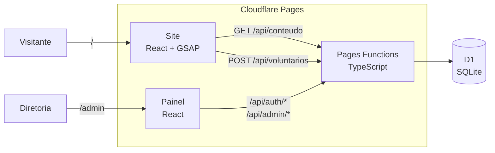
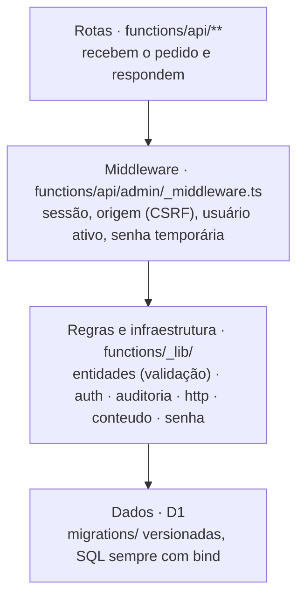
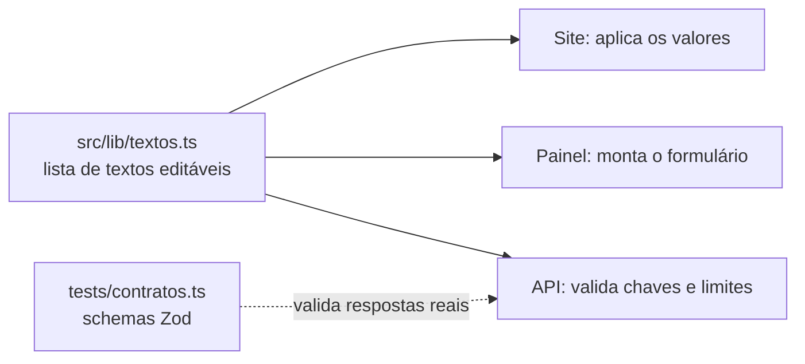
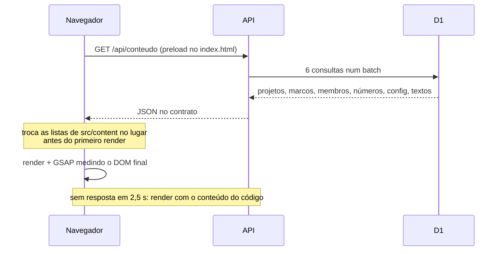
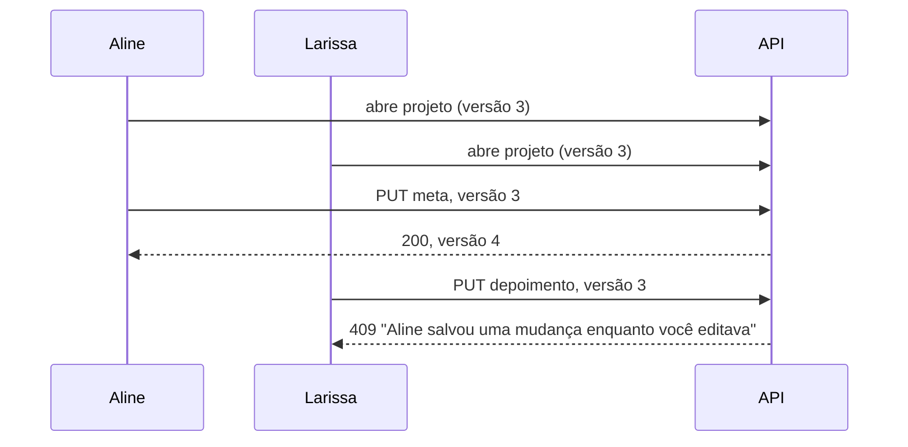

# Arquitetura · Arte de Amar

Um monorepo, um deploy, custo zero (RE01). O Cloudflare Pages publica o
site, o painel e a API juntos; o banco é um D1.

## Hospedagem e quem cuida de cada parte

| parte | onde fica | quem cuida |
|---|---|---|
| site, painel e API | Cloudflare Pages, na conta da ONG | publicação automática a cada push na `main` |
| banco de dados | Cloudflare D1, na mesma conta | a diretoria, pelo painel |
| domínio próprio | Cloudflare, na mesma conta | a ONG paga; a equipe configura |
| código | GitHub (`Gustavo16378/arte-de-amar`) | a equipe |

A conta da Cloudflare fica em nome da ONG para o site não depender de
ninguém da equipe para continuar no ar (RE05). A equipe só precisa de
acesso ao GitHub para publicar mudanças de código.

## Camadas

| camada | onde | responsabilidade |
|---|---|---|
| Rotas | `functions/api/` | Uma rota por arquivo (roteamento do Pages). Leem o pedido, chamam as regras, gravam e respondem. |
| Middleware | `functions/api/admin/_middleware.ts` | Porteiro de tudo em `/api/admin`: token válido, pessoa ainda cadastrada, origem igual à do site, troca de senha pendente. |
| Regras | `functions/_lib/entidades.ts` | Campos de cada cadastro, limites, tipos e regras entre campos. Lista fechada: nenhum nome de tabela ou coluna vem do pedido. |
| Infraestrutura | `functions/_lib/auth.ts`, `http.ts`, `auditoria.ts` | Hash PBKDF2 e JWT com a Web Crypto do runtime, respostas e erros padronizados, registro de auditoria. |
| Dados | `migrations/` e D1 | Esquema com CHECKs e chaves estrangeiras, para o banco recusar dado ruim mesmo se a API errar. |

As rotas falam SQL direto com o D1, sempre por bind. Para o tamanho do
projeto, uma camada de repositório separada seria mais cerimônia do que
ganho; as regras que importam (validação, quem pode o quê, auditoria) já
estão fora das rotas.

## Uma fonte só para o que é compartilhado

A lista de textos editáveis é importada pelo site, pelo painel e pela API.
Os contratos de teste conferem que a API responde no formato que o front
espera. Com front e back em repositórios separados, isso viraria cópia
mantida à mão.

## Fluxo de leitura do site

O conteúdo é aplicado antes do primeiro render de propósito: as seções medem
o DOM para montar as animações (a linha do tempo pinada, o mural da
diretoria), e conteúdo chegando depois deixaria essas medidas erradas.

## Edição simultânea

`UPDATE … SET versao = versao + 1 WHERE id = ? AND versao = ?`: se duas
gravações chegam no mesmo instante, o banco deixa passar só uma.

## Decisões

| decisão | alternativa | por quê |
|---|---|---|
| Pages Functions + D1 | Spring Boot no Render, Strapi no Railway | Custo zero e sem servidor dormindo; o deploy do back vem junto com o do site. |
| Fotos no próprio D1 | Cloudflare R2 | O R2 pede cartão mesmo no plano gratuito. As fotos chegam reduzidas (~0,3 MB). |
| JWT em cookie HttpOnly | token no localStorage | O JavaScript da página nunca vê o token; SameSite=Strict barra outro site. |
| Senha temporária pelo painel | recuperação por e-mail | Envio de e-mail exigiria serviço pago ou mais uma conta para manter. |
| Monorepo | repositórios de front e back | Um deploy, uma fonte para o que é compartilhado, um CI testando tudo junto. |
