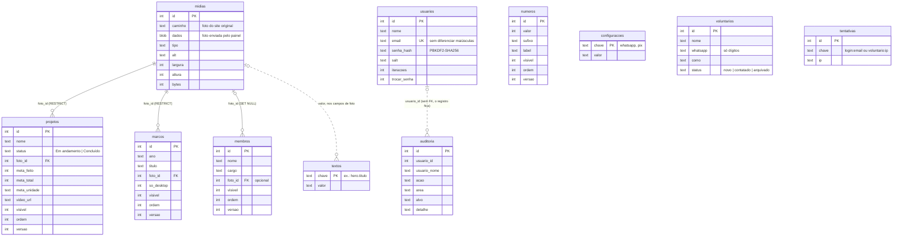

# Modelo do banco · Arte de Amar

Cloudflare D1 (SQLite). O esquema nasce das migrations em
[`migrations/`](../migrations), aplicadas em ordem; nenhuma tabela é criada
à mão.



## Tabelas

| tabela | guarda | observações |
|---|---|---|
| `midias` | fotos | Ou `caminho` (arquivo do site original) ou `dados` (imagem enviada); um dos dois é obrigatório. |
| `projetos`, `marcos`, `membros`, `numeros` | os cadastros do site | `ordem` define a posição no site, `visivel` esconde sem apagar, `versao` protege a edição simultânea. |
| `textos` | textos e fotos fixos trocados no painel | Só existe linha para o que foi trocado; o resto fica com o original do código. |
| `configuracoes` | WhatsApp e chave PIX | Chave e valor. |
| `voluntarios` | inscrições do site | Telefone só com dígitos. |
| `usuarios` | quem entra no painel | Nunca guarda senha, só hash, salt e iterações. |
| `auditoria` | quem fez o quê e quando | Guarda o nome por escrito: o registro continua legível depois que a pessoa sai. Apagada depois de um ano. |
| `tentativas` | freio de login e de inscrição | Apagada depois de um dia. |

## Regras que o próprio banco garante

Mesmo com um bug na API, o banco recusa:

- status, `visivel`, `so_desktop`, `trocar_senha` e ação da auditoria fora
  dos valores previstos (CHECK);
- meta negativa ou total zero; foto com dimensão zero; foto sem arquivo e
  sem bytes;
- e-mail repetido, inclusive com maiúsculas diferentes (UNIQUE NOCASE);
- projeto ou marco apontando para foto inexistente, e apagar foto em uso
  (FOREIGN KEY RESTRICT).

Apagar o retrato de uma pessoa da diretoria deixa a pessoa sem foto
(SET NULL), e o site mostra a moldura com o cargo.

Tudo isso é testado em [`tests/db/schema.test.ts`](../tests/db/schema.test.ts).

## Migrations

| arquivo | o que faz |
|---|---|
| `0001_schema.sql` | esquema inicial e índices |
| `0002_seed.sql` | conteúdo aprovado do site, gerado de `src/content` por `scripts/gerar-seed.ts` |
| `0003_diretoria.sql` | diretoria real com retratos; cargos sem nome ocultos |
| `0004_textos.sql` | tabela dos textos editáveis |
| `0005_usuarios_auditoria.sql` | senha temporária, auditoria e coluna de versão |

Nova mudança de esquema é sempre uma migration nova, com o próximo número.
Migration já aplicada em produção não se edita.

```bash
npm run db:local    # aplica no banco de desenvolvimento
npm run db:remoto   # aplica no banco de produção
```

## Capacidade

O plano gratuito aceita 500 MB por banco. Quase todo o peso são as fotos
enviadas (cerca de 0,3 MB cada); um contato de voluntário tem menos de 1 KB.
O painel mostra o espaço usado em Configurações e avisa a partir de 70%.
